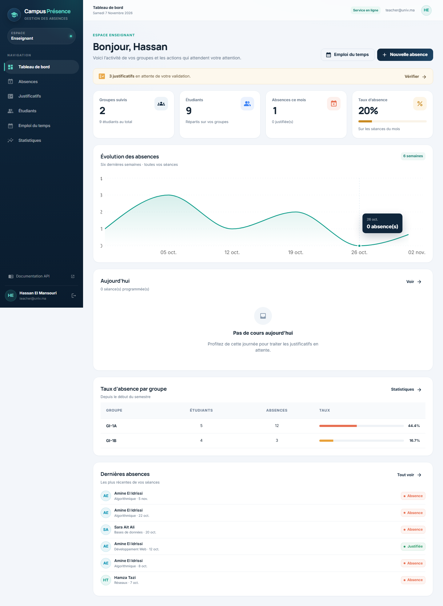
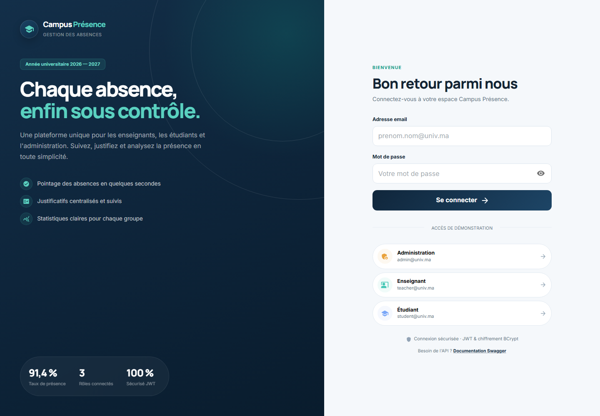
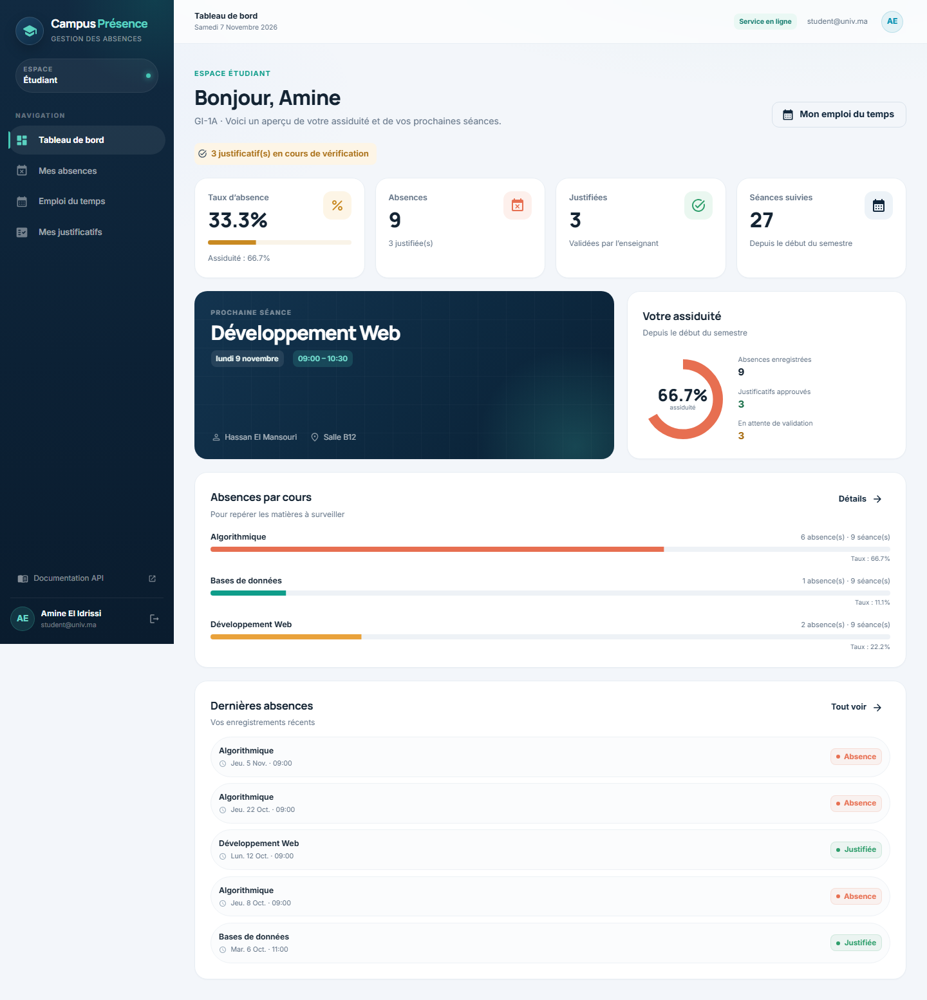
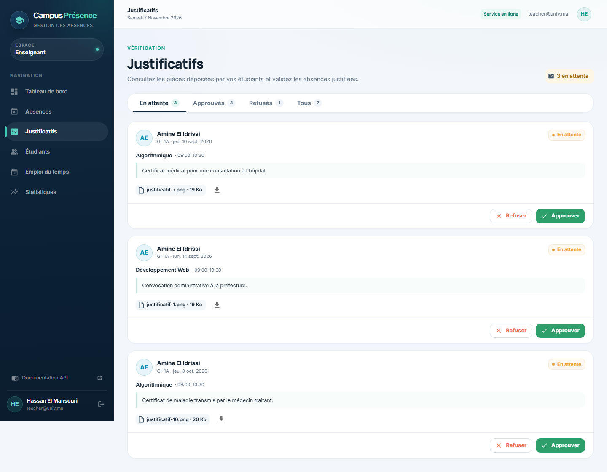
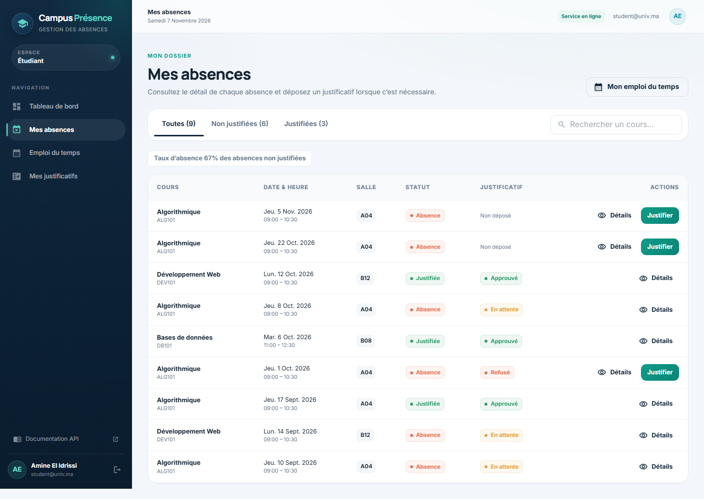
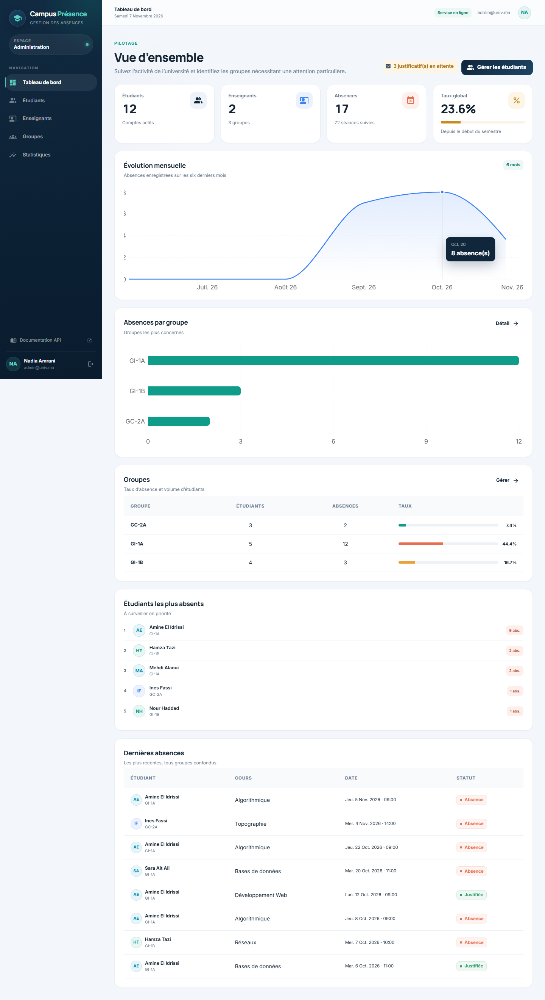
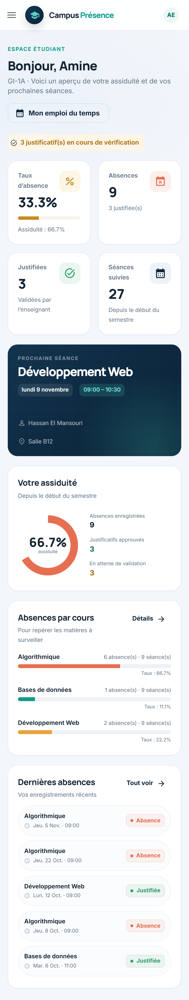

# Campus Présence

**Application web responsive de gestion des absences universitaires** — Spring Boot, React, PostgreSQL et JWT.

Campus Présence couvre le parcours complet : l'administration crée les étudiants, les enseignants et les groupes ; l'enseignant pointe les absences et valide les justificatifs ; l'étudiant consulte son emploi du temps, ses absences et suit ses justificatifs. Les statistiques sont calculées par groupe, par cours et par étudiant.

> **Démo prête à l'emploi** : `.\run.ps1` puis <http://localhost:8080>  
> Comptes : `admin@univ.ma`, `teacher@univ.ma`, `student@univ.ma` (mots de passe ci-dessous).



## Sommaire

- [Aperçu](#aperçu)
- [Fonctionnalités](#fonctionnalités)
- [Stack technique](#stack-technique)
- [Démarrage rapide](#démarrage-rapide)
- [Comptes de démonstration](#comptes-de-démonstration)
- [Mode développement](#mode-développement)
- [Docker + PostgreSQL](#docker--postgresql)
- [Architecture](#architecture)
- [API REST](#api-rest)
- [Sécurité](#sécurité)
- [Tests et vérifications](#tests-et-vérifications)
- [Données de démonstration](#données-de-démonstration)
- [Limites et mise en production](#limites-et-mise-en-production)

## Aperçu

| Connexion | Étudiant |
|---|---|
|  |  |

| Justificatifs enseignant | Absences étudiant |
|---|---|
|  |  |

| Administration | Mobile |
|---|---|
|  |  |

## Fonctionnalités

### Enseignant
- Connexion sécurisée et tableau de bord personnel.
- Consultation des groupes enseignés et des étudiants de chaque groupe.
- Pointage d'une absence sur une séance passée, avec détection des doublons.
- Modification du statut et de la note d'une absence.
- Justification directe d'une absence.
- Historique filtrable par groupe, étudiant, statut et période.
- Consultation et traitement des justificatifs (approbation / refus motivé).
- Emploi du temps hebdomadaire.
- Statistiques : taux d'absence, tendance sur 6 semaines, répartition par groupe.

### Étudiant
- Connexion et tableau de bord personnalisé.
- Emploi du temps de son groupe.
- Consultation de ses absences et du détail de chaque séance.
- Dépôt d'un justificatif (PDF, JPG ou PNG — 5 Mo max).
- Suivi du statut : en attente, approuvé, refusé, avec commentaire de l'enseignant.
- Taux d'absence global et par cours, prochaines séances.

### Administration
- Tableau de bord global et statistiques consolidées.
- Ajout et modification des étudiants, avec rattachement à un groupe.
- Ajout et modification des enseignants.
- Création, modification et suppression sécurisée des groupes.
- Consultation des absences récentes, des groupes à risque et des étudiants les plus absents.

### Transverse
- Authentification JWT stateless et contrôle d'accès par rôle.
- API REST documentée avec Swagger/OpenAPI.
- Interface responsive testée de 390 px à 1440 px.
- Upload sécurisé avec validation du type MIME, de la taille et du nom de fichier.
- Jeu de démonstration réaliste (12 étudiants, 3 groupes, 8 cours, 88 séances, 17 absences, justificatifs).
- Collection Postman incluse.

## Stack technique

| Couche | Choix |
|---|---|
| Backend | Spring Boot 3.5 (REST API), Spring MVC, Spring Data JPA |
| Sécurité | Spring Security 6 + JWT (JJWT), BCrypt, rôles `ADMIN` / `TEACHER` / `STUDENT` |
| Base de données | PostgreSQL 16 en production, H2 en développement |
| Frontend | React 19 + Vite 7 + Material UI 7 |
| Graphiques | Recharts |
| Upload | Spring Multipart + stockage local monté en volume |
| Tests / outils | JUnit 5, MockMvc, Postman, Swagger/OpenAPI, Docker Compose |

## Démarrage rapide

### Prérequis
- Java 21 ou supérieur.
- Aucun autre serveur sur le port `8080`.

### Lancer l'application

```powershell
.\run.ps1
```

Ou directement :

```powershell
java -jar backend/target/campus-presence-1.0.0.jar
```

Ouvrir **<http://localhost:8080>**.

Le jar embarque le frontend compilé et sert l'application et l'API sur le même port. Le profil de développement `dev` utilise une base H2 **en mémoire** : les données de démonstration sont recréées à chaque redémarrage. Swagger est disponible sur <http://localhost:8080/swagger-ui.html>.

Pour reconstruire entièrement le projet (frontend + copie statique + tests + jar) :

```powershell
.\build.ps1
```

## Comptes de démonstration

| Rôle | Email | Mot de passe |
|---|---|---|
| Administration | `admin@univ.ma` | `Admin123!` |
| Enseignant | `teacher@univ.ma` | `Teacher123!` |
| Enseignant (2ᵉ) | `salma@univ.ma` | `Teacher123!` |
| Étudiant | `student@univ.ma` | `Student123!` |

Les autres étudiants de démonstration utilisent `Student123!` (voir `backend/src/main/java/com/university/absence/config/DataSeeder.java`). Des boutons d'accès direct sont proposés sur l'écran de connexion.

## Mode développement

### Backend

```powershell
cd backend
mvn spring-boot:run
```

- API : <http://localhost:8080/api>
- Swagger : <http://localhost:8080/swagger-ui.html>
- Profil par défaut : `dev` (H2 en mémoire, données de démo).

Avec PostgreSQL :

```powershell
$env:SPRING_PROFILES_ACTIVE="prod"
$env:POSTGRES_URL="jdbc:postgresql://localhost:5432/campus_presence"
$env:POSTGRES_USER="campus"
$env:POSTGRES_PASSWORD="campus"
$env:APP_SEED_DEMO="true"
mvn spring-boot:run
```

### Frontend

```powershell
cd frontend
npm install
npm run dev
```

Vite sert l'interface sur <http://localhost:5173> et proxyfie `/api` vers `http://localhost:8080`.

### Variables d'environnement utiles

| Variable | Défaut | Rôle |
|---|---|---|
| `SERVER_PORT` | `8080` | Port HTTP |
| `APP_JWT_SECRET` | secret de dev | Clé HMAC du JWT (≥ 32 caractères) |
| `APP_JWT_EXPIRATION_MS` | `28800000` | Durée du jeton (8 h) |
| `APP_CORS_ORIGINS` | `localhost:5173` | Origines autorisées (liste séparée par des virgules) |
| `APP_STORAGE_LOCATION` | `./uploads` | Dossier des justificatifs |
| `APP_SEED_DEMO` | `true` en dev | Crée le jeu de démonstration |
| `SPRING_PROFILES_ACTIVE` | `dev` | `dev` (H2) ou `prod` (PostgreSQL) |
| `POSTGRES_URL` | — | URL JDBC PostgreSQL |
| `POSTGRES_USER` / `POSTGRES_PASSWORD` | — | Identifiants PostgreSQL |

## Docker + PostgreSQL

Le fichier `docker-compose.yml` démarre PostgreSQL 16 et l'application avec le profil `prod`.

```powershell
Copy-Item .env.example .env
docker compose up --build
```

- Application : <http://localhost:8080>
- PostgreSQL : `localhost:5432` (base `campus_presence`, utilisateur `campus`)
- Volume `uploads` pour les justificatifs, volume `postgres_data` pour la base.

Le seed de démonstration est activé via `APP_SEED_DEMO=true` dans Compose. En production réelle, passez-le à `false` et changez impérativement `APP_JWT_SECRET` et `POSTGRES_PASSWORD`.

## Architecture

```text
Campus Presence
├── backend/                    Spring Boot REST API
│   ├── src/main/java/.../
│   │   ├── config/             sécurité, OpenAPI, seed, CORS
│   │   ├── domain/             entités JPA
│   │   ├── dto/                contrats d'API (records)
│   │   ├── repository/         Spring Data JPA
│   │   ├── security/           JWT, UserDetails, utilisateur courant
│   │   ├── service/            règles métier, statistiques, stockage
│   │   └── web/                contrôleurs REST + gestion d'erreurs
│   ├── src/main/resources/static/   frontend compilé (généré)
│   └── src/test/               tests d'intégration MockMvc
├── frontend/                   React + Vite + MUI
│   ├── src/components/         layout, dialogues, tableaux, graphiques
│   ├── src/pages/              écrans par rôle
│   ├── src/context/            authentification et notifications
│   └── src/api/                client Axios et endpoints
├── docs/                       collection Postman
├── screenshots/                captures de vérification
├── Dockerfile
├── docker-compose.yml
├── build.ps1
└── run.ps1
```

### Modèle de données

- `AppUser` : compte et rôle, rattaché à un `StudentGroup` pour les étudiants.
- `StudentGroup` : promotion / groupe (nom, niveau, département).
- `Course` : matière, enseignant et groupe.
- `CourseSession` : occurrence datée d'un cours (salle, horaires).
- `Absence` : étudiant + séance, statut `ABSENT` ou `JUSTIFIED`, note, auteur.
- `Justification` : pièce jointe, motif, statut `PENDING` / `APPROVED` / `REJECTED`, revue.

Le taux d'absence est calculé comme **absences ÷ séances passées**, ce qui évite de surestimer le taux en début de semestre. Les absences justifiées restent comptabilisées comme absences, mais sont distinguées dans les tableaux de bord.

## API REST

Documentation interactive : **<http://localhost:8080/swagger-ui.html>**  
Collection Postman : [`docs/Campus-Presence.postman_collection.json`](docs/Campus-Presence.postman_collection.json)

| Méthode | Endpoint | Accès |
|---|---|---|
| `POST` | `/api/auth/login` | public |
| `GET` | `/api/auth/me` | authentifié |
| `GET` | `/api/teacher/dashboard` | enseignant |
| `GET` | `/api/teacher/groups` | enseignant |
| `GET` | `/api/teacher/students` | enseignant |
| `GET` | `/api/teacher/schedule` | enseignant |
| `GET` / `POST` | `/api/teacher/absences` | enseignant |
| `PUT` / `DELETE` | `/api/teacher/absences/{id}` | enseignant |
| `POST` | `/api/teacher/absences/{id}/justify` | enseignant |
| `GET` | `/api/teacher/justifications` | enseignant |
| `PATCH` | `/api/teacher/justifications/{id}` | enseignant |
| `GET` | `/api/student/dashboard` | étudiant |
| `GET` | `/api/student/schedule` | étudiant |
| `GET` | `/api/student/absences` | étudiant |
| `GET` | `/api/student/absences/{id}` | étudiant |
| `POST` | `/api/student/absences/{id}/justification` | étudiant (multipart) |
| `GET` | `/api/student/justifications` | étudiant |
| `GET` | `/api/files/justifications/{id}` | propriétaire / enseignant / admin |
| `GET` | `/api/admin/dashboard` | admin |
| `GET` / `POST` | `/api/admin/students` | admin |
| `PUT` | `/api/admin/students/{id}` | admin |
| `GET` / `POST` | `/api/admin/teachers` | admin |
| `PUT` | `/api/admin/teachers/{id}` | admin |
| `GET` / `POST` | `/api/admin/groups` | admin |
| `PUT` / `DELETE` | `/api/admin/groups/{id}` | admin |

### Exemple de connexion

```bash
curl -X POST http://localhost:8080/api/auth/login \
  -H "Content-Type: application/json" \
  -d '{"email":"teacher@univ.ma","password":"Teacher123!"}'
```

La réponse contient `token`. Ajoutez ensuite :

```http
Authorization: Bearer <token>
```

## Sécurité

- JWT signé HMAC-SHA-256, jeton expirant après 8 h par défaut.
- Mots de passe hachés avec BCrypt, jamais renvoyés par l'API.
- Autorisations par rôle au niveau des routes et vérification de propriété dans les services (un enseignant ne peut agir que sur ses séances, un étudiant que sur ses absences).
- Fichiers justificatifs servis via une route authentifiée, avec contrôle d'appartenance.
- Upload limité à 5 Mo, types autorisés PDF/JPG/PNG, nom de stockage UUID non devinable.
- Gestion centralisée des erreurs (400, 401, 403, 404, 409, 500) en JSON.
- CORS configurable et désactivé pour les requêtes non autorisées.
- En-têtes de sécurité Spring Security actifs.

## Tests et vérifications

### Backend

```powershell
cd backend
mvn test
```

Résultat vérifié :

```text
Tests run: 4, Failures: 0, Errors: 0, Skipped: 0
```

Les tests d'intégration couvrent : connexion JWT et rafraîchissement du profil, création d'absence et détection de doublon, contrôle des rôles, dépôt d'un justificatif et approbation par l'enseignant.

### Frontend

```powershell
cd frontend
npm run build
```

Build Vite vérifié, avec découpage des pages par route.

### Parcours navigateur vérifiés (Chrome headless, 1440 px et 390 px)

- Connexion des trois rôles et navigation protégée.
- Rafraîchissement direct d'une URL profonde (`/teacher/absences`).
- Création d'une absence, dépôt d'un justificatif, approbation.
- Création d'un groupe et d'un étudiant par l'administration.
- Absence de débordement horizontal sur mobile.
- Aucune erreur console ou requête HTTP en échec sur les parcours testés.

## Données de démonstration

Le seed crée automatiquement :

- 3 groupes : `GI-1A`, `GI-1B`, `GC-2A` ;
- 2 enseignants et 1 administrateur ;
- 12 étudiants ;
- 8 cours et 88 séances réparties de 8 semaines avant à 2 semaines après la date courante ;
- 17 absences, dont plusieurs avec justificatifs en attente, approuvés ou refusés.

Le jeu de données est déterministe et suffisant pour démontrer les tableaux de bord, les filtres et les graphiques. Pour repartir de zéro en développement, redémarrez simplement l'application (H2 en mémoire).

## Limites et mise en production

- **Emploi du temps** : les séances sont générées par le seed de démonstration. En production, les cours et séances devront être alimentés par le système d'information académique (ou un module d'administration dédié).
- **Stockage des fichiers** : local par défaut (`uploads/`). La classe `FileStorageService` isole le stockage et peut être adaptée à S3/MinIO.
- **Migrations** : `ddl-auto=update` est utilisé pour la démo. Avant une mise en production, ajoutez Flyway/Liquibase et passez à `ddl-auto=validate`.
- **Notifications** : les statuts sont consultables dans l'application ; l'envoi d'emails/push n'est pas branché.
- **Suppression** : les étudiants et enseignants ne sont pas supprimés depuis l'interface (préférence pour la désactivation et la conservation de l'historique). Les groupes ne peuvent être supprimés que s'ils sont vides.
- **Application mobile** : l'interface est une web app mobile-first (React/Vite/MUI). Elle peut être empaquetée en application native ou PWA sans changer l'API.

---

Projet réalisé avec Spring Boot, React, MUI, PostgreSQL et une attention particulière portée aux parcours métier et à l'ergonomie mobile.
